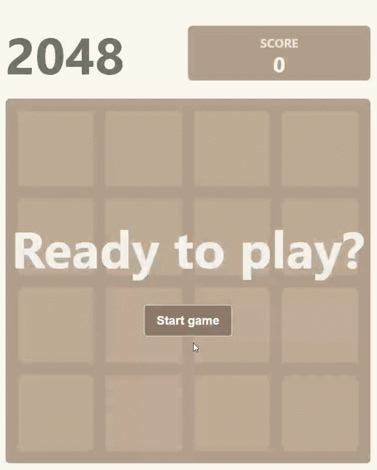

# react-2048

[](https://www.npmjs.comocs/package/react-2048)

A self-contained 2048 game React component.

## Demo

<p align="center">
  
</p>

## Install

```bash
npm install react-2048
```

## Props

The `Game2048` component accepts the following props:

| Name          | Type                                         | Description                                                                 |
|---------------|----------------------------------------------|-----------------------------------------------------------------------------|
| `onGameEnd`   | `(result: { score: number; moves: number; status: "won" \| "lost" }) => void` | Callback fired when the game finishes (winning or losing).                 |
| `onGameStart` | `() => void`                                 | Callback fired when the game begins or is reset.                           |
| `size`        | `"sm" \| "md" \| "lg" \| "xl"`               | Adjusts the overall size of the game board (mobile and desktop).          |
| `className`   | `string`                                     | Additional CSS class applied to the game container.                        |

## Usage

```tsx
import { Game2048 } from "react-2048";

export default function App() {
  return (
    <Game2048
      size="lg"
      onGameEnd={({ score, moves, status }) => {
        console.log({ score, moves, status });
      }}
      onGameStart={() => console.log('game started')}
    />
  );
}
```

## Credits
This component is based on the [2048-in-react](https://github.com/mateuszsokola/2048-in-react) repository.